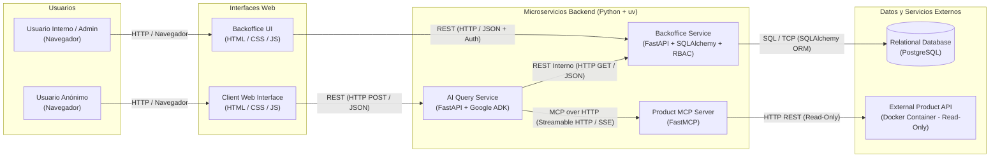
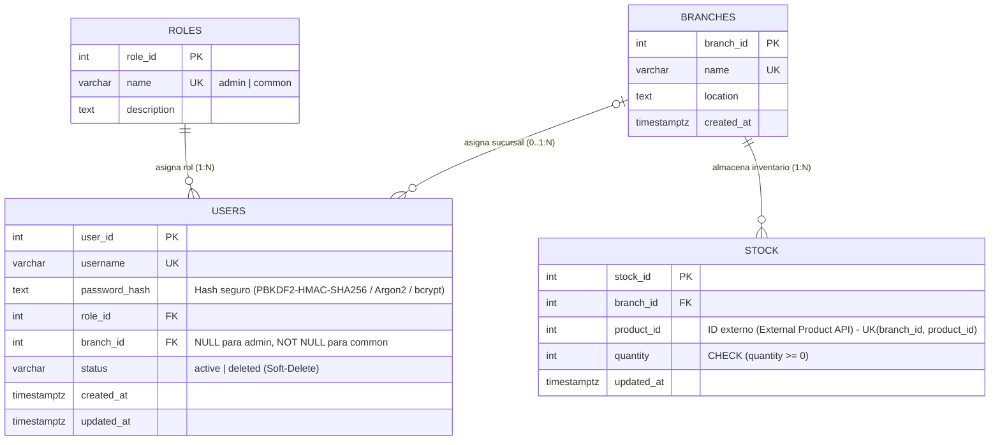

# HBentory - Arquitectura del Sistema

Documento de arquitectura de alto nivel para **HBentory**, un sistema basado en microservicios para la gestión de inventario por sucursal y consultas en lenguaje natural mediante agentes de IA.

---

## 1. Diagrama de Arquitectura del Sistema

---

## 2. Definición de la Arquitectura del Sistema

### 2.1 Servicios y Componentes

| Componente | Tecnología Principal | Responsabilidad |
| :--- | :--- | :--- |
| **Client Web Interface** | HTML5, CSS3, JavaScript | Interfaz ligera tipo buscador/chat para que usuarios anónimos realicen preguntas en lenguaje natural sobre productos y disponibilidad de stock. |
| **AI Query Service** | Python 3.11+, FastAPI, Google ADK | Servicio backend independiente que aloja uno o más agentes de IA. Interpreta la intención del usuario, orquesta llamadas a herramientas MCP (productos) y consulta stock por sucursal para construir una respuesta coherente. |
| **Product MCP Server** | Python 3.11+, FastMCP | Servidor MCP implementado por el equipo que actúa como puente entre el agente de IA y la External Product API, exponiendo capacidades de consulta de catálogo como herramientas estandarizadas. |
| **External Product API** | Contenedor Docker externo (REST) | Fuente de verdad de solo lectura para la información del catálogo de productos. No es modificable por el equipo. |
| **Backoffice Service** | Python 3.11+, FastAPI, SQLAlchemy | Aplicación interna autenticada con control de acceso basado en roles (RBAC). Gestiona usuarios, sucursales y cantidades de stock; además expone un endpoint interno de solo lectura para consultar existencias. |
| **Relational Database** | PostgreSQL | Persistencia relacional local para usuarios, roles, sucursales y stock por sucursal. |

### 2.2 Comunicación entre Servicios

- **Client Web Interface <-> AI Query Service:** Comunicación síncrona mediante **HTTP REST** (`POST /api/query` con payload JSON). El cliente envía la pregunta en texto plano y recibe la respuesta generada por el agente.
- **AI Query Service <-> Product MCP Server:** Comunicación mediante el protocolo **MCP sobre HTTP (Streamable HTTP / SSE)** dentro de la red interna de Docker Compose. El agente de Google ADK descubre e invoca las herramientas expuestas por `FastMCP`.
- **Product MCP Server <-> External Product API:** Comunicación mediante **HTTP REST** (peticiones `GET` de solo lectura) hacia el contenedor de la API externa.
- **AI Query Service <-> Backoffice Service:** Comunicación interna mediante **HTTP REST** (`GET` de solo lectura hacia endpoints internos de stock) para obtener las cantidades disponibles por sucursal sin acoplar el servicio de IA directamente al esquema de PostgreSQL.
- **Backoffice UI <-> Backoffice Service:** Comunicación mediante **HTTP REST** protegido con autenticación (JWT / Bearer Token) y validación de permisos **RBAC**.
- **Backoffice Service <-> PostgreSQL:** Conexión TCP mediante **SQLAlchemy** (ORM y sesiones gestionadas con context managers).

### 2.3 Distribución y Propiedad de los Datos

1. **Datos almacenados localmente (PostgreSQL):**
   - `users`: credenciales (hash), estado de cuenta y metadatos de usuario.
   - `roles` / permisos (RBAC): definición de roles internos (ej. administrador, operador de sucursal).
   - `branches`: catálogo de sucursales (identificador, nombre, ubicación).
   - `stock`: relación entre `branch_id`, `product_id` (referencia externa) y `quantity`.
   - *Restricción:* No se almacenan detalles descriptivos de productos (nombre, descripción, precio, categoría, etc.) en PostgreSQL.

2. **Datos provenientes de la External Product API:**
   - Catálogo completo de productos (ID/SKU, nombre, descripción, categoría, precio y atributos).
   - Datos estrictamente de **solo lectura**, consumidos bajo demanda a través del `Product MCP Server`.

### 2.4 Flujo de Acceso del Agente de IA a Productos y Stock

1. El usuario anónimo escribe una pregunta en la **Client Web Interface** (ej. *"¿Tienen disponible el producto X en la sucursal Centro?"*).
2. La interfaz envía la pregunta vía `POST` al **AI Query Service**.
3. El agente en **Google ADK** analiza la consulta y determina qué datos necesita:
   - Para **detalles de producto** (buscar por nombre, obtener `product_id`, precio o características), invoca una herramienta del **Product MCP Server**, el cual consulta la **External Product API** y devuelve la metadata estructurada.
   - Para **disponibilidad en sucursales**, el agente utiliza una herramienta interna que consulta el endpoint de stock del **Backoffice Service**, el cual lee las cantidades reales desde **PostgreSQL** usando SQLAlchemy.
4. El agente combina la información del catálogo externo con las cantidades locales en PostgreSQL y redacta la respuesta final en lenguaje natural para el usuario.

---

## 3. Diseño de la Base de Datos Relacional (PostgreSQL)

### 3.1 Diagrama Entidad-Relación (ERD)

### 3.2 Restricciones de Integridad y Reglas de Esquema

| Tabla | Restricción / Mecanismo PostgreSQL | Regla y Propósito |
| :--- | :--- | :--- |
| `stock` | `UNIQUE (branch_id, product_id)` | Garantiza una única fila de existencias por producto en cada sucursal, evitando duplicados y habilitando operaciones idempotentes y atómicas de suma/resta (`INSERT ... ON CONFLICT` o `UPDATE` por clave compuesta). |
| `stock` | `CHECK (quantity >= 0)` | Impide existencias negativas directamente a nivel del motor de base de datos, actuando como última línea de defensa ante condiciones de carrera o validaciones incompletas en la capa de aplicación. |
| `users` | Regla de alcance de sucursal (`role_id` vs `branch_id`) en inicialización y capa RBAC | Aplicada en la inicialización y capa de servicio RBAC: todo usuario con rol `common` debe tener exactamente un `branch_id` asignado (`NOT NULL`), mientras que el único usuario `admin` mantiene `branch_id = NULL` porque gestiona usuarios y sucursales pero no opera stock. |
| `users` | Unicidad de `admin` en inicialización y capa RBAC | Aplicada en la inicialización y capa de servicio RBAC (pudiendo reforzarse en producción con un índice único parcial sobre rol `admin` activo), asegurando que exista un único administrador inicial en el sistema. |
| `roles`, `branches`, `users` | Claves únicas (`UK`) y `CHECK (status IN ('active', 'deleted'))` | Aseguran unicidad de nombres de rol (`admin`, `common`), nombres de sucursal y `username`, además de restringir los estados válidos para el borrado lógico de usuarios. |

### 3.3 Justificación del Diseño de la Base de Datos (Por qué de cada decisión)

1. **Por qué NO existe una tabla `products` local (Frontera de datos y *Single Source of Truth*):** El catálogo de productos pertenece exclusivamente a la `External Product API` (solo lectura). Persistir únicamente `product_id` como referencia lógica en `stock` cumple la restricción obligatoria de no almacenar metadatos de producto (nombre, descripción, precio, imágenes) en PostgreSQL, evita datos obsoletos (*stale data*) ante cambios del proveedor y mantiene el bajo acoplamiento entre microservicios.
2. **Por qué se separan `branches` y `stock` (Normalización 3NF y cardinalidad N:M con catálogo externo):** Una sucursal puede tener múltiples operadores asignados y decenas de productos distintos en inventario. Separar `stock` de `branches` evita duplicar datos de sucursal o usuarios por cada producto, habilita actualizaciones concurrentes seguras sobre filas individuales `(branch_id, product_id)` y delega en PostgreSQL la garantía de no negatividad (`quantity >= 0`).
3. **Por qué `users` referencia directamente a `branches` (`branch_id` N:1) y a `roles` (RBAC estricto):** Las reglas del dominio exigen que un usuario común solo pueda estar asignado a **1 sucursal** y solo opere el stock de dicha sucursal, mientras que el administrador gestiona usuarios y asignaciones sin tocar inventario. Modelar `branch_id` como clave foránea directa en `users` (nullable solo para `admin`) impone estructuralmente la relación 1-sucursal-por-operador y simplifica la autorización RBAC en cada endpoint de FastAPI.
4. **Por qué se utiliza borrado lógico (`status`) y `password_hash`:** El administrador debe poder dar de baja usuarios (*soft-delete*) y reasignar sucursales sin destruir el registro histórico ni romper referencias; además, almacenar exclusivamente `password_hash` con algoritmos adaptativos (PBKDF2-HMAC-SHA256 / Argon2 / bcrypt) protege las credenciales frente a accesos no autorizados a la base de datos.

### 3.4 Reglas de Validación de Stock e Inicialización Segura

Las cuatro reglas de integridad de inventario se aplican de forma simple en dos capas complementarias:

1. **Capa de base de datos (PostgreSQL / SQLAlchemy):**
   - `CHECK (quantity >= 0)` (`ck_stock_positive`) impide almacenar existencias negativas en `stock`.
   - `UNIQUE (branch_id, product_id)` (`uq_branch_product`) asegura una única fila de stock por producto y sucursal.
   - `FOREIGN KEY (branch_id)` obliga a referenciar una sucursal válida existente en `branches`.
2. **Capa de aplicación (`update_stock` en `src/hbentory/backoffice/seed.py`):**
   - Exige que `quantity` sea un entero positivo (`int` distinto de `bool` y `> 0`).
   - Verifica en sesión que `branch_id` exista en `branches`.
   - Cuando `check_api=True`, consulta `GET {PRODUCT_API_URL}/api/v1/products/{product_id}` para confirmar que el `product_id` existe en la External Product API (`HTTP 200`).
   - Rechaza operaciones `remove` que dejarían el stock resultante por debajo de `0`.
3. **Inicialización segura de contraseñas (`hash_password`):**
   - El seed genera un salt aleatorio de 16 bytes con `secrets.token_hex(16)` y deriva el hash con `hashlib.pbkdf2_hmac("sha256", ..., 100_000)`, almacenando el formato `salt$digest` sin guardar contraseñas en texto plano.

---

## 4. Registro de Decisiones de Comunicación (ADR)

### Decisión 1: Backoffice — REST + HTML/CSS/JS vs. Server-Side Rendering (SSR)

- **Opción seleccionada:** **REST API (FastAPI) + Frontend desacoplado (HTML/CSS/JS)**.
- **Beneficio principal:** Separa claramente la lógica de negocio y el acceso a datos de la presentación. FastAPI genera documentación OpenAPI automática para probar los endpoints de autenticación, RBAC y stock, y la misma API REST sirve tanto al panel Backoffice como a las consultas internas de stock del `AI Query Service`.
- **Trade-off / Limitación principal:** Requiere gestionar explícitamente en el cliente el envío de tokens de autenticación, estados de carga y configuración de CORS, lo que añade un poco más de código frontend frente a renderizar plantillas HTML directamente en el servidor con Jinja2.

### Decisión 2: Client Web Interface — REST vs. WebSockets

- **Opción seleccionada:** **REST (HTTP POST estándar)**.
- **Beneficio principal:** Máxima simplicidad de implementación, pruebas y depuración para un flujo directo de pregunta-respuesta. Evita mantener conexiones persistentes, manejar reconexiones en el navegador o gestionar estado de sockets en el backend.
- **Trade-off / Limitación principal:** No permite streaming progresivo de tokens ni actualizaciones push en tiempo real; el usuario debe esperar a que el agente complete toda la inferencia y las llamadas a herramientas antes de ver la respuesta.

### Decisión 3: AI Query Service <-> Product MCP Server

- **Opción seleccionada:** **MCP sobre HTTP (Streamable HTTP / SSE) con FastMCP**.
- **Beneficio principal:** Permite ejecutar el `AI Query Service` y el `Product MCP Server` como microservicios independientes en contenedores Docker separados (desacoplamiento de procesos, despliegue y dependencias).
- **Trade-off / Limitación principal:** Introduce latencia de red local entre contenedores y exige configurar timeouts, manejo de errores HTTP y URLs de servicio en variables de entorno, en comparación con la comunicación directa por `stdio` en un mismo proceso.

---

## 5. Definición del Producto Mínimo Viable (MVP)

El objetivo del MVP es garantizar la integración completa de punta a punta de todos los componentes obligatorios antes de añadir mejoras secundarias.

### 5.1 Qué se implementará primero (Core del MVP)

1. **Infraestructura base (`compose.yml`):** Orquestación de los servicios (`postgres`, `external-product-api`, `backoffice`, `product-mcp-server`, `ai-service`, `client-web`) en una red interna común.
2. **Esquema en PostgreSQL y Backoffice Service:**
   - Modelos SQLAlchemy para `users`, `roles`, `branches` y `stock`.
   - Autenticación con FastAPI (login con JWT) y RBAC básico (ej. `admin` vs `staff`).
   - Endpoints REST CRUD para gestionar sucursales y actualizar stock, más un endpoint interno de lectura de stock.
   - Interfaz HTML/CSS/JS mínima funcional para login y gestión de stock.
3. **Product MCP Server:**
   - Servidor con `FastMCP` exponiendo herramientas esenciales de solo lectura sobre la External Product API (listar/buscar productos y obtener detalle por ID).
4. **AI Query Service:**
   - Servicio FastAPI con agente de Google ADK conectado al `Product MCP Server` y con capacidad de consultar el stock del Backoffice.
   - Endpoint `POST` que recibe una pregunta y devuelve la respuesta en JSON.
5. **Client Web Interface:**
   - Página estática simple con cuadro de texto/chat anónimo conectada vía `fetch` REST al `AI Query Service`.

### 5.2 Qué se dejará para después (Post-MVP)

- Streaming de respuestas en tiempo real (migración o soporte paralelo de WebSockets / SSE hacia el cliente).
- Historial de conversaciones persistente por sesión de usuario en la Client Web Interface.
- Caché (ej. Redis) para respuestas frecuentes de la External Product API.
- Auditoría detallada de movimientos de inventario (log histórico de cambios de stock).

### 5.3 Funcionalidades opcionales (Solo si alcanza el tiempo)

- Filtros avanzados, búsqueda y paginación en las tablas del Backoffice UI.
- Exportación de reportes de stock por sucursal (CSV/JSON).
- Arquitectura multi-agente especializada en Google ADK (ej. agente de catálogo separado de agente de inventario).
- Suite automatizada de pruebas de integración end-to-end en CI.
